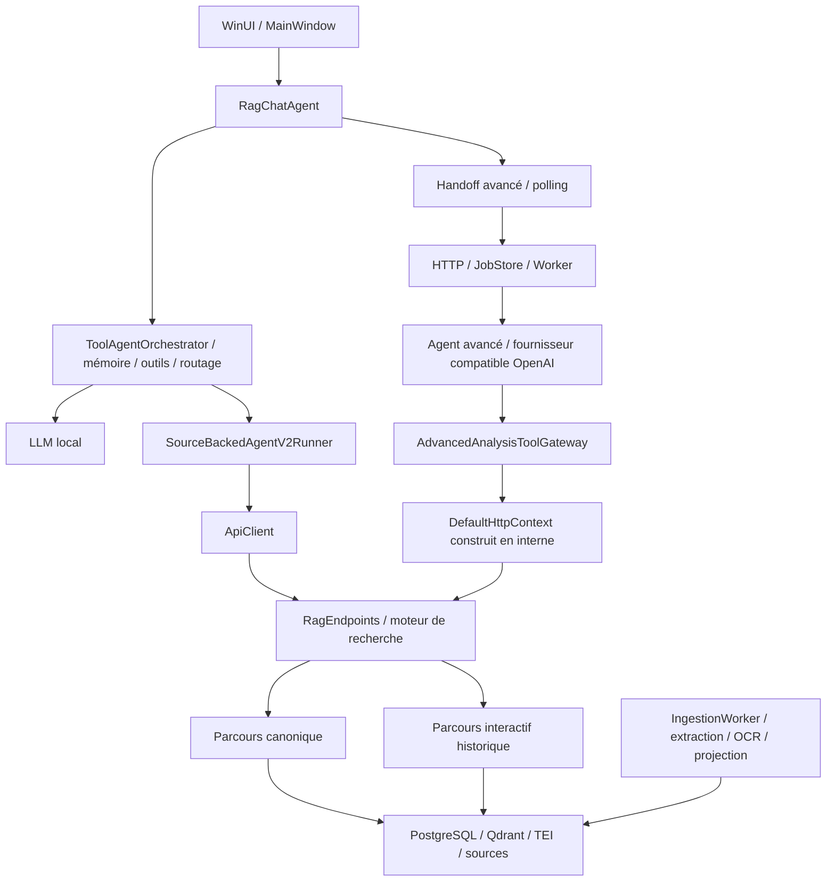

# Audit de structure, de maintenabilité et de diagnostic SAAIA

Date : 24 octobre 2026. Référence auditée : `5131dee30131c1206f6a2881d615ce53a0764682`, branche `SAAIA_V3.1`.

## 1. Conclusion et portée réelle

Le doute exprimé est fondé. Le projet dispose de protections utiles, mais son organisation rend certaines modifications, certains audits et certains diagnostics inutilement difficiles. Le principal problème n'est pas seulement la longueur des fichiers : plusieurs responsabilités restent réunies dans les mêmes classes, y compris lorsqu'elles sont réparties en centaines de fichiers `partial`.

Les sondes ne sont pas absentes partout. Il existe des traces de retrieval, des traces client, des journaux d'appels LLM et de coûts, des diagnostics de runtime local, une disponibilité des dépendances et des exports support. Cependant, elles ne constituent pas encore un parcours de diagnostic continu. Certaines mesures sont même trompeuses. En test réel, on peut constater une réponse lente ou insuffisante sans pouvoir expliquer précisément où le temps et les sources ont été perdus.

La priorité proposée est donc : **rendre les mesures fiables et relier les étapes, puis extraire les responsabilités sans changer simultanément les règles métier**. Une réécriture générale ou un simple découpage en fichiers plus courts augmenterait le risque sans résoudre le fond du problème.

Cet audit comprend le client, le backend, les contrats, les tests, les scripts de validation, la configuration locale et les frontières de démarrage, jobs, dépendances et support. Il combine inventaire automatique et lecture des parcours critiques. Il ne constitue pas une analyse de joignabilité exhaustive de chaque branche ni une inspection des configurations déployées sur le serveur.

**Réalisé pendant cet audit :** lectures du code, évaluation MSBuild sans build du produit, inventaire de 1 267 fichiers sources suivis, analyse syntaxique de 1 159 fichiers C#, vérifications manuelles et trois contre-exemples exécutés hors ligne. Le petit inspecteur d'audit a été compilé et exécuté localement.

**Pas réalisé :** modification du fonctionnement produit, ajout de sondes de production, suppression de code, refactorisation, campagne Terra/RunPod, appel payant, test du serveur ou validation du binaire WinUI installé. Les sondes décrites ci-dessous sont un inventaire et une spécification de travail, pas des corrections déjà livrées. Le statut produit reste `TESTE_NON_APPROUVE`.

## 2. Mesures reproductibles

Les lignes physiques sont comptées sur les fichiers suivis à la référence ci-dessus ; les répertoires générés `bin/obj/node_modules` sont exclus. Extensions : C#, XAML, PowerShell, Python, JavaScript et TypeScript. La classification tests/produit repose sur les chemins : elle ne remplace pas les profils de compilation.

| Périmètre | Fichiers sources hors chemins de tests | Lignes physiques | Fichiers dans les chemins de tests | Lignes de tests |
|---|---:|---:|---:|---:|
| Backend | 231 | 119 991 | 129 | 80 670 |
| Client | 598 | 179 309 | 185 | 91 617 |
| Contracts | 14 | 2 914 | 5 | 503 |
| Tools | 73 | 28 997 | 3 | 536 |
| Infra | 23 | 3 798 | 2 | 269 |

L'inventaire inclut aussi un fichier de banc de test et trois sources déjà suivies sous `artifacts`. Ces chiffres décrivent du volume, pas une note de qualité.

| Point de concentration | Mesure | Ce que cela révèle |
|---|---|---|
| `Endpoints/RagEndpoints.cs` | **36 839 lignes physiques** dans un fichier | Le moteur de recherche et ses politiques sont largement enfouis dans une classe HTTP. |
| `ToolAgentOrchestrator` | **246 fichiers, 83 184 lignes physiques** ; 80 864 lignes dans les déclarations du type | Le découpage `partial` conserve une seule grande frontière de responsabilités. |
| `SourceBackedAgentV2Runner` | **137 parties**, 31 506 lignes dans les déclarations du type | Le nouveau parcours lui-même demande des frontières internes plus fortes. |
| `MainWindow` | **29 parties**, 16 153 lignes dans les déclarations du type | Présentation, actions et orchestration restent fortement liées. |
| `OpenAiCompatibleAdvancedAnalysisProvider` | **22 parties**, 8 702 lignes dans les déclarations du type | Le fournisseur agrège plusieurs fonctions de l'agent avancé. |
| `SearchCoreAsync` | **3 377 lignes**, début à `RagEndpoints.cs:1863` | Une méthode porte de nombreuses décisions de recherche. |
| `SourceBackedAgentV2Runner.RunAsync` | **2 490 lignes**, début à `SourceBackedAgentV2Runner.cs:6` | Machine à états implicite et transitions difficiles à vérifier. |
| `tools/run-llm-validation.ps1` | **8 388 lignes**, 174 fonctions | Le banc historique contient aussi un moteur de réponses. |

Les mesures de déclarations excluent les imports et certaines parties conditionnelles ; elles ne doivent pas être confondues avec les lignes physiques des fichiers. Les types imbriqués peuvent se recouvrir : ne pas additionner les lignes de tous les types pour calculer la taille du dépôt. L'inspecteur utilise les symboles `DEBUG`, `TRACE`, `SAAIA_TEST_HOOKS` ; zéro erreur de syntaxe a été relevée sous ce profil, sans que cela constitue une compilation de toutes les variantes.

Les fichiers de tests sont eux-mêmes très concentrés : `SourceBackedAgentV2Tests.cs` dépasse 16 000 lignes, `RetrievalRuntimeSwitchTests.cs` 13 000 et `DocumentFoundationIntegrationTests.cs` approche 10 000. Cela complique la recherche de scénarios et l'entretien de leurs prérequis.

## 3. Carte des frontières actuelles

Deux nuances évitent de nettoyer le mauvais code : l'analyse avancée demande `SourceBackedCanonical=true` et bifurque tôt vers le parcours canonique (`RagEndpoints.cs:1877`). Elle n'exécute pas systématiquement les milliers de lignes du parcours interactif historique. Ce dernier reste appelé par le produit ; sa taille et son ancienneté ne prouvent pas qu'il soit mort.

## 4. Constats structurels et conséquences

### A01 — Responsabilités sans frontière dans le moteur de recherche — priorité haute

`SearchCoreAsync` mélange contexte HTTP, analyse de requête, politiques linguistiques, choix de retrievers, SQL, récupération supplémentaire, fusion, sélection, provenance et projection. Les aides restent dans la même classe géante. Exemples : politique de recherche à partir de `RagEndpoints.cs:1906`, récupération supplémentaire vers `:3324`, accès SQL dès `:460`.

Le problème concret est la portée d'un changement : une correction de recherche peut modifier une politique utilisée ailleurs sans contrat explicite. Une extraction en fichiers `partial` n'empêcherait pas ces dépendances privées.

Cible : endpoints minces ; contexte de recherche explicite ; moteur canonique et moteur interactif composant retrievers, sélection et projection. Préserver d'abord les sorties et invariants de chaque parcours. Ne pas réunifier de force leurs politiques.

### A02 — Dépendances internes dirigées vers la couche HTTP — priorité haute

`AdvancedAnalysisToolGateway.cs:389` construit un `DefaultHttpContext`, puis appelle `RagEndpoints.SearchCoreAsync` à `:449`. La télémétrie appelle `RagEndpoints.ResolveRetriever` (`RetrievalTelemetry.cs:227`) ; le catalogue réutilise aussi ses normalisations (`DocumentsEndpoints.cs:548`).

Un worker ne devrait pas avoir à simuler une requête HTTP pour accéder au moteur métier. Cible : `IRetrievalEngine` et `RetrievalExecutionContext` partagés par les adaptateurs HTTP et jobs ; classificateurs/normalisations sortis de la classe d'endpoints. Cela permet aussi une corrélation explicite sans détour par `HttpContext.Items`.

### A03 — Machines à états et mémoire globale du client — priorité haute

Les 246 parties de `ToolAgentOrchestrator` partagent les mêmes dépendances, aides privées et mémoire. Le runner V2 possède une longue boucle et de nombreux drapeaux : état candidat, audit, sélection, protocole, progression, budgets et issue terminale. Les transitions ne sont pas exprimées comme un petit ensemble de décisions typées.

La mémoire distingue déjà préférences/workspace/session/exécution (`ToolMemory.cs:302`), mais conserve de nombreuses surfaces mutables de compatibilité (`:38`). Ce commentaire est honnête ; le regroupement ne suffit simplement pas à protéger les responsabilités.

Cible : état immuable ou à propriétaire explicite par requête, transitions nommées et issues terminales exclusives ; mémoire de session séparée de cet état et du journal diagnostique. Extraire les composants autour de comportements stables, pas autour d'un nombre arbitraire de lignes.

### A04 — Le noyau client est lié à WinUI et aux détails privés — priorité moyenne

Les tests de l'agent référencent le projet WinUI avec `SAAIATestHooks=true` (`SAAIA.Client.ToolAgent.Tests.csproj:24`). Certains remplacent `ApiClient._http` par réflexion (`CanonicalToolExecutionContractTests.cs:35`) ou recherchent des transformations privées par nom (`CanonicalPdfCitationContractTests.cs:61`). Le polling peut même construire l'orchestrateur avec `llm: null!` (`MainWindow/AdvancedAnalysisTracking.cs:163`).

Cible : transport et service d'analyse avancée autonomes, dépendances injectables, noyau applicatif sans WinUI, tests de contrats observables. Les hooks restent utiles pendant la migration ; ils ne constituent pas une interface de diagnostic du logiciel installé.

### A05 — Pipeline d'ingestion trop concentré — priorité moyenne

`IngestionWorker.ProcessUpsertAsync` commence à `:1019` et occupe environ mille lignes : extraction/Docling/OCR, réconciliation, unités, chunks, embeddings, Qdrant, publication et nettoyage. Ses chronométrages sont utiles, mais liés à l'ensemble de la méthode.

Cible : étapes à entrées/sorties typées et mesures systématiques ; le worker conserve la boucle, les leases, retries et finalisation. Ne pas déplacer la publication transactionnelle sans tests réels des erreurs partielles et reprises.

### A06 — Deux règles d'ouverture documentaire selon l'entrée UI — priorité moyenne

La carte source transmet hash/révision/chunk/ancre et exige un hash exact (`SourcesCardsControl.xaml.cs:66`). Le lien dans le texte ne transmet que chemin/page (`LinkifiedTextBlock.Documents.cs:13`). `DocumentLauncher.cs:53` choisit donc des résolutions différentes. Un succès Windows de lancement à `DocumentLauncher.cs:187` ne prouve pas l'affichage de la bonne page.

Cible : `SourceLocator` typé partagé par toutes les entrées, politique explicite pour références incomplètes, événements séparant résolution, validation d'identité et lancement. Les tests actuels de citation décrivent honnêtement leur limite : ils ne pilotent pas une fenêtre PDF.

### A07 — Migrations sans coordination globale entre instances — risque à vérifier

`DbMigrator.cs:44` vérifie la version avant la transaction ouverte à `:53`, sans verrou global ni checksum du contenu appliqué. Deux instances pourraient observer simultanément une migration absente. Une modification ultérieure d'un fichier déjà appliqué ne serait pas détectée.

Il s'agit d'un risque déduit du code, non reproduit pendant cet audit. Prévoir un verrou de migration, une empreinte et un test de démarrage concurrent. Les numéros `004`/`008` dupliqués sont gérés par identité de nom complet : ne pas renommer des migrations déployées pour une raison esthétique.

## 5. Tests et outils : ce qui peut donner une fausse confiance

### V01 — Des tests non exécutés sont comptés comme réussis — priorité haute

Des tests retournent normalement si PostgreSQL n'est pas configuré : `AdvancedAnalysisWorkerTests.cs:162`, helper à `:1215` ; `DocumentFoundationIntegrationTests.cs:29`, helper vers `:9860`. Un scan a repéré 206 branches de ce type dans 18 fichiers : c'est un compte de motifs, pas un nombre certifié de tests distincts.

Des tests live font de même après avoir écrit « Skipped » (`LiveAdvancedAnalysisProviderTests.cs:13`, `LiveOpenAiTerraProviderTests.cs:13`). xUnit considère ce retour comme un succès. Sur 53 fichiers `Live*.cs`, 45 ne portent pas de `Trait`, ce qui rend insuffisant un simple filtre de catégorie.

Ce constat ne retire pas les preuves des campagnes PostgreSQL isolées réellement effectuées précédemment. En revanche, **un grand total vert ne signifie pas que tous les parcours concernés ont été exécutés**. Leurs prérequis et résultats doivent être lisibles dans un manifeste.

Cible : profils `Unit`, `IntegrationPg`, `LiveLocal`, `LivePaid`, vrais skips dans une suite générale, échec explicite si un profil demandé ne peut pas s'exécuter. Le profil hors ligne doit neutraliser les drapeaux live hérités et inclure Contracts.

### V02 — Mesures incorrectes dans `runtime-ci-harness.ps1` — priorité haute

Trois défauts ont été reproduits en exécutant uniquement deux fonctions extraites par AST, avec HTTP simulé localement :

1. Zéro échantillon retourne `ok=true`, motif `not_enough_samples` (`:169`).
2. Deux réponses sans mesure de débit peuvent produire `tokPerSecDriftPercent=0` et `ok=true` (`:181`).
3. La requête est non streamée, puis `ttftMs=elapsedMs` (`:124–156`) : c'est la durée complète, pas le temps au premier token.

Autre constat statique : le test nommé `runtime_recovery_probe` effectue seulement `GET /v1/models` (`:266`) ; aucune panne ni reprise n'est provoquée. Il faut distinguer disponibilité, génération, performance, annulation et reprise. Une donnée absente doit être `unavailable` ou `insufficient_samples`, jamais une réussite implicite.

Ces exécutions hors ligne prouvent des défauts du harnais, pas une défaillance du modèle ni une validation du produit. Résultats : `artifacts/architecture-audit-20261024/harness-counterexamples.json`.

### V03 — Tests parfois liés au texte du code plutôt qu'au comportement — priorité moyenne

`SourceBackedRagArchitectureTests.cs:111` impose des chaînes avec indentation et retours à la ligne exacts. À `:97`, l'absence littérale de `return null` sert de garantie. `ToolScriptsSafetyNetTests.cs:22` vérifie surtout la présence de mots ; cela ne détecte pas les faux indicateurs précédents.

53 fichiers de tests lisent directement des sources ; ce n'est pas intrinsèquement mauvais. Conserver les véritables invariants architecturaux, remplacer les assertions de présentation du code par des contrats d'options et de comportement. Sinon un déplacement légitime casse les tests et un défaut fonctionnel peut rester vert.

### V04 — Banc historique et runtime produit insuffisamment distingués — priorité moyenne

`tools/run-llm-validation.ps1` contient un moteur actif : `Invoke-LlmAnswer` à `:7189`, sorties `deterministic_*` à `:7218`, `:7290`, `:7310`, etc. Ce n'est pas du code mort. Mais `tools/LLM_VALIDATION.md:33` et `:67` ne distinguent plus assez ce comparateur historique de la direction actuelle donnant les décisions sémantiques au modèle.

Des scripts choisissent aussi implicitement de vieux profils « final » (`test-openai-terra-campaign-profile.ps1:34`). Préserver les profils immuables pour reproduire les campagnes, mais exiger un profil explicite ou un manifeste actif unique avec statut, commit et périmètre.

### V05 — Pas de porte d'entrée commune complète pour la validation — priorité moyenne

Aucun workflow `.github` suivi, `.editorconfig` global ou `Directory.Build.props` trouvé. Le harnais général lance backend et client mais omet Contracts (`runtime-ci-harness.ps1:206`). Son rapport manque de commit, modèle/corpus effectifs et identifiant de campagne (`:277`).

Cible : une commande documentée, profils explicites, environnement maîtrisé, manifeste et résultats reliés à la trace du parcours testé. Ajouter des garde-fous progressifs ; imposer immédiatement une règle de taille à tout le dépôt créerait une dette de contournements.

## 6. Sondes existantes à préserver

- Retrieval : `RetrievalTelemetry` possède activités, phases, dégradations, durées et volumes ; des tests capturent de vraies `Activity` (`RetrievalTelemetryTests.cs:104`).
- Backend : intégrations OpenTelemetry ASP.NET/HttpClient et métriques de gouvernance. L'activation est toutefois `false` par défaut dans les options et configurations locales ; le serveur n'a pas été inspecté. Les deux sources métier enregistrées sont Retrieval et RuntimeGovernance (`OpenTelemetryServiceCollectionExtensions.cs:50`).
- Client : `RAG_TRACE` numéroté avec durée et tampon de 240 événements (`ToolAgentOrchestrator.RagTrace.cs:18`), logs tournants, événements de modèle avec identifiant d'appel/usage/erreur (`OpenAiLlmClient.cs:238`).
- Fournisseurs externes : le budget journalise modèle, rôle, job, identifiants fournisseur, usage, coût, latence et essais (`AdvancedAnalysisExternalBudgetGuard.cs:250`). Ce journal exclut volontairement prompts et secrets.
- Capture exacte avancée : `OpenAiCompatibleAdvancedAnalysisProvider.DevelopmentTrace.cs:45` écrit déjà requête sérialisée, empreinte SHA-256, réponse, completion et contexte d'appel lorsque `DevelopmentTraceDirectory` est renseigné. Elle existe dans le parcours réel, pas seulement dans les tests ; elle est désactivée par défaut.
- Runtime local : diagnostics de build requis/actif, compatibilité, modèle, profil et warmup (`LocalLlmRuntimeDiagnosticsService.cs:9`).
- Disponibilité : `/ready` teste réellement DB, embedding TEI, Qdrant et aspects OCR/configuration. Les jobs disposent d'états, leases, checkpoints et preuves finales.

Le travail consiste à compléter et relier ce socle, pas à lui superposer un deuxième système indépendant de logs.

## 7. Inventaire des sondes manquantes, partielles ou trompeuses

Priorités : **P0** = fiabiliser avant de tirer de nouvelles conclusions de performance/qualité ; **P1** = nécessaire au diagnostic du parcours réel ; **P2** = approfondissement et exploitation. Ces priorités de travail ne prétendent pas être une classification de sécurité.

| ID | Priorité / frontière | État observé et manque | Question que la sonde doit résoudre |
|---|---|---|---|
| S01 | P0 — performance client | Orchestrateur recréé à chaque tour ; compteurs remis à zéro ; `diagnostic.performance` lit le tour courant et ignore `lastN`. | Combien a réellement duré la question précédente et dans quelles phases ? |
| S02 | P0 — mesure du parcours complet | `_lastTotalMs` est arrêté avant le handoff serveur. | Quelle durée l'utilisateur a-t-il réellement attendue, serveur et affichage compris ? |
| S03 | P0 — banc performance | Faux TTFT, débit absent validé, zéro échantillon accepté ; reprise non testée. | La mesure a-t-elle eu lieu et que mesure-t-elle exactement ? |
| S04 | P1 — UI → API → worker | IDs locaux/job existent, sans parent durable commun. | Retrouve-t-on tous les événements d'une seule question ? |
| S05 | P1 — fin HTTP | Log de fin après `await`, sans `finally` ; scope fermé avant le log du middleware d'erreur extérieur. | Comment cette requête a-t-elle fini, y compris en exception/annulation ? |
| S06 | P1 — retrieval canonique | Gateway force `IncludeDiagnostics:false` ; les preuves finales ne donnent pas les candidats éliminés. | La recette n'a-t-elle pas été récupérée ou a-t-elle été écartée après récupération ? |
| S07 | P1 — résultat retrieval | Compteur métier enregistré à la fin seulement. | Combien de recherches ont échoué ou été annulées avant de produire un résultat ? |
| S08 | P1 — outils avancés | `tool_name` persisté est toujours `source_backed_canonical_search`, même pour lecture/recherche de texte. | Quel outil a réellement été demandé et exécuté ? |
| S09 | P1 — file avancée | État présent, transitions/retries/reprises et pertes de lease pas tous conservés. | Le délai vient-il de la file, d'une exécution, d'une panne ou d'une reprise ? |
| S10 | P1 — worker avancé | `/ready` ne prouve pas worker vivant ni provider avancé prêt. | La capacité avancée peut-elle prendre et terminer un job maintenant ? |
| S11 | P1 — projection envoyée au modèle | Capture exacte avancée optionnelle existante ; manque de synthèse homogène de composition et de liaison aux autres parcours. | Quelles sections/outils/sources étaient effectivement visibles, avec quelles limites ? |
| S12 | P1 — exécution LLM commune | Journal externe couplé au budget ; provider serveur client ne passe pas par le même journal. | Peut-on comparer local, OpenAI, RunPod et serveur client avec les mêmes mesures ? |
| S13 | P1 — boucle d'agent | Événements dispersés, pas une chronologie commune de transitions/outils/validation et issue terminale. | Pourquoi l'agent a-t-il reformulé, relu, réessayé ou décidé d'arrêter ? |
| S14 | P1 — polling client | Certaines erreurs transitoires sont absorbées sans événement structuré par tentative. | Pourquoi l'UI attend-elle alors que le serveur a avancé, ou inversement ? |
| S15 | P1 — ingestion/OCR | Excellent récapitulatif au succès, pas de finalisation équivalente sur échec intermédiaire. | Quelle étape a échoué et quelles données étaient déjà produites ? |
| S16 | P1 — preuves affichées | Pas de bilan uniforme sources reçues/acceptées/rejetées et motifs ; un `catch` de dialogue est silencieux. | Une citation a-t-elle été perdue dans le transport, le parser ou l'UI ? |
| S17 | P1 — ouverture source | Logs d'identité existants mais pas de durée ni parent du tour ; garanties différentes carte/lien. | Quelle version et quelle page ont été résolues, et quel lancement a été accepté ? |
| S18 | P1 — export support | Export paramètres sans snapshot agent ; erreurs de copie facultative silencieuses. | Le paquet de diagnostic contient-il réellement les preuves attendues du tour échoué ? |
| S19 | P1 — configuration effective | Informations réparties entre réglages, licence, profils et readiness ; pas un manifeste unique de campagne/parcours. | Quels modèle, route, capacités, budgets et révisions étaient vraiment actifs ? |
| S20 | P2 — démarrage/migrations | HTTP indisponible avant fin de migrations ; pas de progression détaillée par migration. | Le logiciel est-il bloqué, encore en migration ou sorti avant l'ouverture du port ? |
| S21 | P2 — disponibilité en cache | `/ready` conserve ancien `RequestId` et `Ts` dans le corps pendant le cache. | Le résultat correspond-il à cette requête ou à un contrôle précédent ? |
| S22 | P2 — dépendances | HTTP instrumentable, mais pas de source métier uniforme ingestion/job/LLM ni instrumentation Npgsql enregistrée ici. | Le temps est-il passé en SQL, TEI, Qdrant, OCR ou génération ? |
| S23 | P1 — intégrité des tests | Retours silencieux et pas de manifeste commun des prérequis/scénarios réellement exécutés. | Le scénario a-t-il été exécuté, ignoré, échoué ou seulement préparé ? |
| S24 | P0 — fonctionnement des sondes | Activation OTel optionnelle ; hooks conditionnels absents d'un Release standard ; collecte partielle non déclarée ; une capture avancée trop grande ou impossible à écrire peut faire échouer le job. | Les sondes étaient-elles actives, complètes et sans effet bloquant sur la réponse ? |
| S25 | P1 — présence dans l'index | Les traces de recherche seules ne distinguent pas document absent et document présent mais non récupéré. | La révision/page/unité attendue est-elle publiée et interrogeable dans l'index canonique ? |

### Preuves principales derrière l'inventaire

**S01–S02.** `RagChatAgent.cs:221` crée l'orchestrateur ; `RunPipeline.cs:39` réinitialise les diagnostics ; `State.cs:9` remet les champs à zéro. `ToolExecution.cs:426` ignore les arguments de `diagnostic.performance`, dont le manifeste annonce pourtant `lastN`. `RuntimeSnapshot.cs:61` lit les compteurs courants. `TurnFinalization.cs:55` arrête la mesure avant le handoff de `RagChatAgent.cs:244`. Cible : `TurnDiagnosticRecord` finalisé une fois, historique borné indépendant de l'instance et `lastN` effectif.

**S04.** Trace créée dans `RagTrace.cs:43`, après le début UI ; requêtes construites dans `ApiClient.cs:127` sans propagation métier du tour. Une instrumentation HttpClient peut propager une Activity HTTP lorsqu'elle est active ; cela ne crée pas à elle seule le lien métier durable avec le job asynchrone et la source ouverte. Le gateway utilise `advanced:{jobId}:{callNumber}` (`AdvancedAnalysisToolGateway.cs:394`).

**S05–S08.** `RequestIdMiddleware.cs` écrit le log de fin seulement après `_next`. Le middleware d'erreur est extérieur (`WebApplicationExtensions.cs:27`). `AdvancedAnalysisToolGateway.cs:469` désactive les diagnostics détaillés ; `RagEndpoints.SourceBackedCanonical.cs:200` ne les construit alors pas. `RetrievalTelemetry.cs:184` et `AdvancedAnalysisJobStore.cs:372` portent les autres limites. Le JSON de requête conserve la vraie opération d'outil : l'information n'est donc pas perdue partout, mais la colonne principale est trompeuse.

**S09–S10.** Le worker ignore le nombre de leases expirées récupérées (`AdvancedAnalysisWorker.cs:91`), le retry réussi est silencieux (`:226`), le claim efface le dernier code d'erreur (`AdvancedAnalysisJobStore.cs:169`). `/ready` contrôle le LLM de `ChatOptions` via `/v1/models` (`ReadyEndpoints.cs:307`), tandis que provider avancé et worker ont leur propre configuration (`ServiceCollectionExtensions.cs:225`, `AdvancedAnalysisWorker.cs:49`). C'est une limite de la preuve de disponibilité, pas la démonstration d'une panne actuelle.

**S11–S13.** Le journal externe riche de `AdvancedAnalysisExternalBudgetGuard.cs:250` est à préserver. Il n'est activé que pour les fournisseurs externes (`OpenAiCompatibleAdvancedAnalysisProvider.cs:48`). La capture exacte optionnelle existe aussi pour le provider avancé (`OpenAiCompatibleAdvancedAnalysisProvider.DevelopmentTrace.cs:45`, appel sur succès dans `Provider.cs:969`). Séparer diagnostic d'exécution et facturation ; relier ces traces aux sections, décisions observables et autres parcours plutôt que recréer une deuxième capture.

**S14–S18.** Polling : `AdvancedAnalysisExecution.cs:323`. Ingestion : récapitulatif vers `IngestionWorker.cs:1972`. Sources : `MainWindow/Messages.cs:438`, `DocumentLauncher.cs:46`. Export actif paramètres : `UserSettingsDialog.RepairAndSupport.cs:24`, sans snapshot ; export agent : `ExportSupportAndDebugTools.cs:29`, avec snapshot. `SupportBundleBuilder.cs:183` n'inclut `agent-runtime.json` que si ce snapshot existe ; `:290` ignore des erreurs de copie.

**S20–S24.** Migrations avant ouverture HTTP : `Program.cs:51`, `DbMigrator.cs:55`. Cache readiness : `ReadyEndpoints.cs:47`, `:267`. Sources métier enregistrées : `OpenTelemetryServiceCollectionExtensions.cs:50`. Hooks conditionnels : `ToolAgentOrchestrator.TestHooks*.cs`, profil forcé par le projet de tests. Une sonde utile dans les tests ne suffit pas à diagnostiquer un binaire distribué.

**S24, défaut de la collecte elle-même.** Si la capture avancée est activée, plus de 3 000 000 caractères entraîne `advanced_development_trace_limit_exceeded` (`DevelopmentTrace.cs:62`) et une erreur disque `advanced_development_trace_write_failed` (`:74`). L'écriture est attendue avant le retour du résultat modèle (`Provider.cs:969`), après la clôture éventuelle de sa facturation. Une génération réussie peut donc devenir un échec de job à cause de la sonde. Constat statique, non reproduit ici. Prévoir mode best-effort en production et mode strict explicite pour une campagne dont la capture intégrale est une condition d'acceptation ; signaler distinctement « collecte incomplète » et « génération échouée ».

**S25.** Les APIs et données canoniques existantes doivent servir à un contrôle ciblé doc/révision/page/unité, corrélé à l'ingestion et à la recherche. Un résultat vide du retriever ne prouve pas une absence de l'index. La présence doit être vérifiée séparément, sans requête exhaustive du corpus à chaque question.

## 8. Contrat de diagnostic recommandé

Un événement ou span doit expliquer une opération, pas seulement annoncer « passage ici ». Un petit schéma commun doit couvrir les différents fournisseurs et adaptateurs.

### Champs communs

- `schemaVersion`, version du code, empreinte de configuration effective et version du contrat/prompt/outils.
- `traceId`, `spanId`, `parentSpanId`, identifiants conversation/message/tour ; `jobId`, tentative, worker et appel fournisseur lorsqu'ils existent.
- Opération et phase, début UTC, durée monotone, issue parmi `success`, `failed`, `cancelled`, `degraded`, `skipped`, `unavailable` ; code de motif stable.
- Route décidée et motif, modèle demandé/observé, provider, profil et limites effectives. Pas de clé ni d'URL contenant des secrets.
- Compteurs propres à la phase : candidats, sources, caractères/tokens, rejets, retry et budget. Valeur inconnue explicite, jamais zéro inventé.

`traceId/jobId` appartiennent aux logs/spans et aux manifestes, pas aux labels de métriques à forte cardinalité. Les métriques agrègent opération/provider/outcome/cause bornée. Le contexte de trace doit être persisté avec un job asynchrone, pas seulement porté par une AsyncLocal.

Le temps au premier token n'existe que s'il est mesuré sur un vrai flux avec sa définition précise. Distinguer temps total utilisateur, attente de file, exécution serveur, premier événement/texte utile, génération et affichage. Ne pas soustraire des horodatages de machines différentes pour estimer une durée sans traitement de leur décalage d'horloge.

### Diagnostic d'une source qui disparaît

Pour chaque appel de recherche, conserver des compteurs avant/après phase et, dans un mode diagnostic borné, un échantillon d'identifiants de candidats : retriever, score, rang, révision, page et cause de rejet (`scope`, `version`, `quality`, `threshold`, `duplicate`, `limit`, etc.). Déclarer l'échantillonnage et les troncatures. Cela distingue « non récupéré », « récupéré puis filtré », « visible au modèle » et « citation perdue après réponse ». Pour conclure « absent de l'index », ajouter le contrôle de présence ciblé S25 : les traces de candidats ne suffisent pas.

### Diagnostic de ce que voit le modèle

Pour chaque appel : rôle, outils proposés, outil choisi, version du schéma, tailles des sections system/user/history/evidence/tools, identifiants/révisions des preuves, limites et troncatures, usage fournisseur et issue de parsing/validation. Une empreinte permet de comparer deux entrées ; elle ne permet pas à elle seule de les comprendre.

S'appuyer sur le **mode de capture exacte déjà présent** dans le provider avancé : requête réellement sérialisée après toutes les projections, réponse fournisseur et completion. Compléter sa corrélation aux réponses d'outils et aux projections, sa synthèse par section, ses quotas/rétention et son comportement sur erreur de collecte ; étendre le contrat aux autres parcours. Ce mode sert à vérifier ce qu'on donne au modèle sans enregistrer tout le corpus en permanence. Il ne s'agit pas de collecter un raisonnement privé du modèle ; seulement ses décisions/actions observables et les données échangées.

### Confidentialité et santé de la collecte

Les traces actuelles peuvent déjà contenir un extrait de question (`RagTrace.cs:55`) et de réponse (`TurnFinalization.cs:77`). Le bundle masque certains secrets et le provisioning, mais copie des logs bruts (`SupportBundleBuilder.cs:143`). « Secrets masqués » ne signifie donc pas « questions et documents anonymisés ». Aucun export ni incident de fuite n'a été provoqué ou constaté pendant cet audit.

Par défaut, préférer identifiants, volumes et motifs. Publier dans chaque bundle/manifeste les pièces présentes, absentes ou en erreur, le mode de contenu, les bornes de rétention, les événements perdus et les sondes actives. Une panne du collecteur ne doit pas bloquer une réponse ; elle doit être visible comme un diagnostic incomplet.

## 9. Code mort, fichiers inactifs et commentaires

### Nettoyages fortement étayés

- `RagEndpoints.LoadRagDocumentSourceHashesAsync` (`RagEndpoints.cs:1599`) : aucune autre occurrence trouvée, même dans les tests. Le chemin actif utilise les identités enrichies.
- `RagEndpoints.ResolveDocumentSourceHash` (`:1122`) : référence uniquement dans un test historique (`RetrievalRuntimeSwitchTests.cs:8775`). Migrer ou retirer ce test avec l'ancienne aide ; ne pas maintenir une API privée uniquement pour lui donner de la couverture.
- `Test-ValidationPromptSourcesHaveCompetingRecipeTitle` (`run-llm-validation.ps1:2977`) : aucune invocation AST ni autre référence trouvée. Candidat de suppression fortement étayé, après dernière vérification des appels dynamiques lors de la modification.
- `UserSettingsDialog.xaml` / `.xaml.cs` : exclus explicitement de la compilation dans le `.csproj`. Commentaire « reference-only » correct. La duplication peut être sortie de l'arborescence active ou supprimée si Git suffit à la conserver.

Ce sont des constats statiques ciblés, pas la preuve que toutes les familles historiques sont inaccessibles. Aucun de ces éléments n'a été supprimé pendant l'audit.

### Pourquoi une suppression automatique serait dangereuse

L'inspecteur trouve **129 méthodes privées sans référence C# par identifiant**. **43** ont cependant une référence lexicale XAML ; **3** ont une référence par chaîne exacte, éventuellement recoupée. Par exemple `TestReady_Click` est appelé depuis le XAML du wizard. Les autres cas nécessitent examen de la compilation, génération, réflexion, delegates et chemins actifs. Une absence de résultat dans `rg` n'est pas une preuve générale de code mort.

Les anciennes campagnes, profils et réponses déterministes encore appelées doivent être classés comme historiques/actifs/proposés, pas supprimés sur la base de leur nom.

### Commentaires périmés vérifiés

- `SAAIA.Client.WinUI.csproj:27` demande de réactiver l'outillage MSIX alors que `EnableMsixTooling` est déjà `true`. Corriger l'explication, ne pas changer la valeur pour la faire correspondre au commentaire.
- `RagEndpoints.cs:21757`, `ApplyAutocut` promet de conserver au moins un résultat, mais un dernier filtrage peut tout retirer ; le retour précoce sur de petites listes introduit aussi une nuance. Documenter puis confirmer la règle produit avant de modifier l'algorithme.
- `WebApplicationExtensions.cs:26` affirme que le middleware d'erreur est premier, alors que Swagger/fichiers statiques précèdent son enregistrement.
- `OpenTelemetryOptions.cs:5` promet « aucun overhead » si désactivé : l'export est désactivé, pas tous les chronométrages et constructions de diagnostics applicatifs.
- `ToolAgentOrchestrator.cs:59` annonce un maximum générique de cinq appels RAG ; certains chemins d'exploration disposent de budgets plus élevés. Le commentaire doit décrire son véritable périmètre.

Conserver les commentaires expliquant les invariants et les raisons ; retirer ou réécrire ceux qui paraphrasent un ancien patch comme s'il décrivait toujours le comportement actuel.

## 10. Ordre de travail proposé et critères de sortie

| Lot | Travail concret | Preuve attendue avant de poursuivre |
|---|---|---|
| 1 — Mesures honnêtes | Corriger S01–S03 et le caractère bloquant de la collecte S24 ; vrais skips/prérequis et manifeste de campagne ; corriger disponibilité/reprise mal nommées. | Zéro scénario non exécuté compté comme exécuté ; historique de plusieurs tours ; temps local et avancé distincts ; données absentes déclarées ; erreur de collecte distinguée d'une erreur du modèle. |
| 2 — Parcours corrélé | Trace racine avant le départ UI, en-têtes API, parent persisté du job ; fin systématique, transitions et export commun. | Une question normale, une erreur, une annulation et une reprise reconstituables avec un seul identifiant dans le binaire normal. |
| 3 — Explication documentaire/modèle | Candidats et rejets par phase, journal LLM indépendant du budget, contrat/payload/outils réellement transmis, capture bornée pour tests. | Pour une source attendue, expliquer où elle entre/sort et démontrer ce qui était visible au modèle, sans copie systématique du corpus. |
| 4 — Premières extractions | Service de transport/polling avancé et ouverture typée ; moteur canonique appelé sans faux `HttpContext`. | Même comportement/provenance, contrats publics testables, moins de dépendances vers UI/Endpoints ; scénarios et sondes des lots précédents inchangés. |
| 5 — Décomposition du noyau | Noyau client sans WinUI, transitions du runner, retrieval interactif et ingestion par étapes. | Chaque composant possède son état, ses entrées/sorties et ses erreurs ; tests de comportement sans réflexion pour les interfaces extraites. |
| 6 — Assainissement durable | Retrait du code inutilisé démontré, classement des profils/scripts, commentaires et garde-fous progressifs. | Graphe production/tests séparé, différences relues, aucune suppression sur nom seul, avertissements/nouvelles concentrations suivis. |

Chaque lot doit rester petit, commitable et vérifiable. Ne pas modifier simultanément les prompts, les politiques de sélection et l'architecture d'exécution : cela empêcherait d'attribuer une régression à sa cause. Les sondes s'ajoutent au composant propriétaire au fil des extractions, avec un contrat commun dès le début.

La cible doit rester compatible avec la vision local/serveur client/cloud : décision de capacité, exécution de l'agent et transport du modèle sont des responsabilités différentes. Licence et configuration d'installation sélectionnent des capacités et adaptateurs ; elles ne devraient pas imposer une nouvelle orchestration pour chaque emplacement du LLM. La refonte des installateurs n'est pas comprise dans ce lot d'audit.

Les tests à ajouter doivent vérifier des événements réellement émis, une fin unique, les champs et causes, en cas de succès, erreur, annulation, timeout et reprise. Pour le retrieval : source présente, récupérée puis rejetée, tronquée avant modèle et refusée à l'affichage. Pour le support : pièce manquante et collecte partielle. Pour les fournisseurs : même schéma sans dépense réelle grâce à des adaptateurs simulés.

Une petite campagne réelle sur le binaire installé complète ensuite ces tests. Les évaluations sémantiques Terra/RunPod restent distinctes : une architecture mieux rangée et des tests hors ligne verts ne prouvent pas à eux seuls la qualité finale du planning de repas.

## 11. Éléments reproductibles livrés avec l'audit

Répertoire : `artifacts/architecture-audit-20261024/`.

- `inventory-manifest.json`, `tracked-source-metrics.json`, `source-hashes.json` : périmètre, volumes et empreintes des sources inspectées.
- `summary.json` : concentrations principales et méthodes les plus longues, pour consultation compacte.
- `probe-inventory.json` : les 25 frontières de diagnostic, priorités, manques et questions à résoudre, reprises du tableau de ce rapport.
- `methodology.json`, `parse-errors.json`, `unreferenced-private-candidates.json` : méthode, limites et candidats à examiner, avec références XAML/chaînes.
- `harness-counterexamples.json` et `Invoke-HarnessCounterexamples.ps1` : preuves exécutables hors ligne des trois mesures trompeuses.
- `inspector/Inspector.csproj`, `inspector/Program.cs`, `New-SourceInventory.ps1` : sources de l'outil d'inventaire. Aucun package NuGet supplémentaire ; Roslyn provient du SDK .NET installé.
- `README.md` : commandes et limites de reproduction. Les métriques complètes méthodes/types sont générées localement ; le résumé versionné suffit à retrouver les concentrations sans ajouter plusieurs mégaoctets de listes au dépôt.

Vérifications de ce lot : inventaire exécuté, inspecteur exécuté sans erreur de syntaxe sous son profil, évaluation MSBuild backend/client, exclusion effective du dialogue XAML historique confirmée, trois contre-exemples reproduits, cohérence des liens et `git diff --check`.

Les suites produit n'ont pas été relancées pour ce lot documentaire : il n'y a pas de modification produit à valider ici. Aucun crédit API consommé. Les défauts recensés restent à corriger selon les lots ci-dessus.
